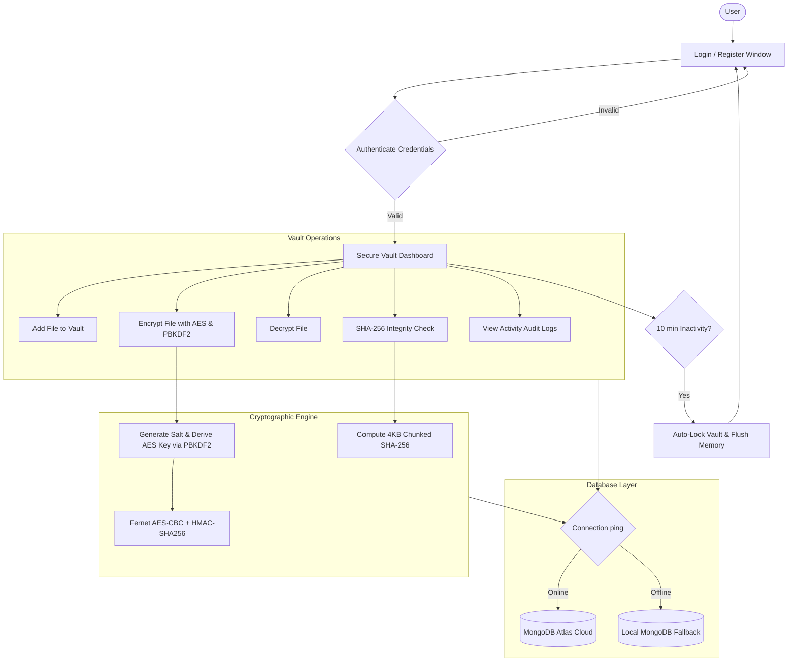

# Secure File Vault 🔐📁

> **An enterprise-grade, cryptographically secure desktop file vault built with Python, Tkinter, AES encryption (Fernet), PBKDF2HMAC key derivation, SHA-256 integrity verification, and MongoDB.**

[](https://www.python.org/)
[](https://docs.python.org/3/library/tkinter.html)
[-darkgreen)](https://cryptography.io/)
[](https://cryptography.io/en/latest/hazmat/primitives/key-derivation-functions/)
[-green?logo=mongodb&logoColor=white)](https://www.mongodb.com/)
[](LICENSE)

---

## 📌 Overview

**Secure File Vault** is a security-focused desktop application designed to protect sensitive files and enforce data confidentiality, cryptographic integrity, and granular activity auditing. Built following the core tenets of information security (CIA Triad: Confidentiality, Integrity, and Availability), it provides users with an intuitive desktop interface to encrypt files at rest, verify cryptographic checksums, track security events, and manage data securely across both local and cloud MongoDB databases.

---

## 🛡️ Core Security Architecture & Features

### 1. 🔑 Cryptographic File Encryption
- **Symmetric Authenticated Encryption**: Implements the **Fernet** specification from the Python `cryptography` hazard-tested primitives. Fernet uses **AES in CBC mode with a 128-bit key** and PKCS7 padding, authenticated using **HMAC-SHA256** to prevent both eavesdropping and ciphertext tampering.
- **Robust Key Derivation (PBKDF2HMAC)**:
  - Algorithm: `SHA-256`
  - Salt: Cryptographically secure 16-byte random salt generated per-file via `os.urandom(16)`
  - Work Factor: **390,000 iterations** (exceeding standard OWASP/NIST guidelines to mitigate brute-force and GPU-accelerated dictionary attacks)
  - Key Length: 32 bytes (256-bit derived key URL-safe base64-encoded)
- **Secure File Lifecycle**: Upon encryption, original unencrypted plaintexts are safely shredded from disk, leaving only the authenticated `.enc` ciphertext. Decryption reconstructs the original file only upon valid master password entry.

### 2. 🔍 SHA-256 File Integrity Verification
- Computes baseline **SHA-256 cryptographic digests** using a memory-efficient chunked reader (4 KB blocks), ensuring stability even with large file sizes.
- Real-time **Integrity Verification Engine**: Re-computes and cross-references active file hashes against stored MongoDB metadata to instantly detect unauthorized file modifications, ransomware tampering, or bit-rot corruption.

### 3. 👤 User Authentication & Credential Security
- **Salted Password Hashing**: Passwords are never stored in plaintext. They are salted with unique random salts and hashed via PBKDF2HMAC.
- **Enforced Password Complexity**: Real-time password strength meter requiring 8+ characters, uppercase letters, lowercase letters, numbers, and special characters (`@$!%*?&`).
- **Cryptographic Password Recovery**: Implements a zero-knowledge security question (hashed hobby verification via SHA-256) allowing authorized password resets without compromising stored credentials.

### 4. ⏱️ Automated Vault Lockout
- **Inactivity Session Watchdog**: Automatically locks the vault interface after **10 minutes of inactivity** (monitoring keyboard, click, and mouse wheel activity).
- Flushes the transient in-memory password cache to protect data against unauthorized physical access on unattended workstations.

### 5. 📜 Tamper-Evident Activity Auditing
- Dedicated audit trail subsystem recording every security event with username, action identifier, context/filename, and UTC timestamps.
- Monitored actions include: `register_success`, `login`, `add_file`, `encrypt_file`, `decrypt_file`, `verify_integrity`, `auto_lock`, `password_reset_success`, and `logout`.

### 6. 🌐 Hybrid Database Resilience (Atlas Cloud + Local Fallback)
- **Automatic Health Check**: At startup, tests connection latency to MongoDB Atlas cloud cluster with a 5-second timeout.
- **Graceful Offline Fallback**: If internet connectivity is interrupted or cloud cluster is unreachable, seamlessly switches to local MongoDB instance (`localhost:27017`) ensuring zero disruption to local vault operations.

---

## 🏗️ System Workflow



---

## 📂 Repository Structure

```text
secure-file-vault/
├── docs/                                    # Academic & Project Documentation
│   ├── Secure_File_Vault_Project_Report.docx # Comprehensive internship project report
│   ├── Secure_File_Vault_Presentation.pptx   # Project presentation slides
│   ├── Cyber_Security_Internship_Synopsis.pdf # Academic synopsis (PDF)
│   └── Cyber_Security_Internship_Synopsis.docx# Academic synopsis (Word)
├── db.py                                    # Database connection & dual-tier fallback
├── gui_login.py                             # Main login interface & window routing
├── gui_register.py                          # User registration with password strength regex
├── gui_forgot_password.py                   # Secure password reset via cryptographic hobby hash
├── gui_vault.py                             # Primary vault dashboard (Add, Encrypt, Decrypt, Verify)
├── gui_logs.py                              # Activity log viewer interface
├── main.py                                  # Application entry point
├── models.py                                # Data access layer & business logic
├── security.py                              # Cryptographic primitives (Fernet, PBKDF2, SHA-256)
├── requirements.txt                         # Python package dependencies
├── .env.example                             # Environment configuration template
├── .gitignore                               # Git ignore rules for secrets, caches, and logs
├── LICENSE                                  # MIT License
└── README.md                                # Project documentation
```

---

## 🗄️ Database Schema Overview

The application organizes data across three primary MongoDB collections in the `secure_file_vault` database:

### 1. `users` Collection
| Field | Type | Description |
|---|---|---|
| `_id` | ObjectId | Unique identifier |
| `username` | String | Unique username |
| `password_hash` | Binary | PBKDF2-derived 256-bit password hash |
| `salt` | Binary | 16-byte random salt for password derivation |
| `hobby_hash` | String | SHA-256 hex digest of password recovery hobby |
| `created_at` | DateTime (UTC) | User registration timestamp |

### 2. `files` Collection
| Field | Type | Description |
|---|---|---|
| `_id` | ObjectId | Unique identifier |
| `owner` | String | Associated username |
| `file_name` | String | Name of the file |
| `file_path` | String | Absolute filesystem path (or `.enc` encrypted path) |
| `encrypted` | Boolean | Encryption status flag |
| `sha256_hash` | String | Current SHA-256 cryptographic checksum |
| `salt` | Binary | 16-byte random salt used for file encryption key derivation |
| `last_modified` | DateTime (UTC) | Last modified timestamp |

### 3. `logs` Collection
| Field | Type | Description |
|---|---|---|
| `_id` | ObjectId | Unique identifier |
| `user` | String | Username who initiated action |
| `action` | String | Action type (`login`, `encrypt_file`, `decrypt_file`, `auto_lock`, etc.) |
| `file_name` | String | File or context target |
| `timestamp` | DateTime (UTC) | Event timestamp |

---

## 🚀 Getting Started

### Prerequisites
- **Python 3.10+** (Tested on Python 3.12)
- **MongoDB** (Local instance on `mongodb://localhost:27017` OR free [MongoDB Atlas Cluster](https://www.mongodb.com/atlas))

### Installation

1. **Clone the repository**:
   ```bash
   git clone https://github.com/Aditya-tmu/secure-file-vault.git
   cd secure-file-vault
   ```

2. **Create and activate a virtual environment**:
   ```bash
   # Windows (PowerShell)
   python -m venv venv
   .\venv\Scripts\Activate.ps1

   # Linux / macOS
   python3 -m venv venv
   source venv/bin/activate
   ```

3. **Install required dependencies**:
   ```bash
   pip install -r requirements.txt
   ```

4. **Configure Environment Variables**:
   Copy `.env.example` to `.env`:
   ```bash
   # Windows
   copy .env.example .env

   # Linux / macOS
   cp .env.example .env
   ```
   Open `.env` and fill in your connection strings:
   ```env
   ATLAS_URI=mongodb+srv://<username>:<password>@cluster0.xxxxx.mongodb.net/?retryWrites=true&w=majority
   LOCAL_URI=mongodb://localhost:27017
   DB_NAME=secure_file_vault
   ```
   *(If you don't have MongoDB Atlas, the application will automatically connect to your local MongoDB).*

5. **Run the Application**:
   ```bash
   python main.py
   ```

---

## 📖 Usage Guide

1. **Register**: Click **Register** on the initial window. Create a username, enter a password satisfying complexity rules, and provide a security recovery answer.
2. **Login**: Authenticate with your username and password.
3. **Add File**: Click **Add File** to import any document, image, or sensitive archive into the vault manager.
4. **Encrypt**: Select the file and click **Encrypt**. Enter your vault password. The file is encrypted into a `.enc` container and the unencrypted file is securely removed.
5. **Verify Integrity**: Select any file and click **Verify Integrity**. The app re-reads the file in 4KB chunks, computes the live SHA-256 hash, and compares it to the database checksum to confirm tamper-free integrity.
6. **Decrypt**: Select an encrypted file and click **Decrypt**. Supply your master password to restore the original file.
7. **Audit Logs**: Click **View Logs** anytime to inspect the chronological audit trail of all vault operations.

---

## 🔒 Security Best Practices Implemented

- ✅ **No Hardcoded Secrets**: All database connection strings and sensitive configurations are loaded via environment variables (`python-dotenv`).
- ✅ **Proper Key Derivation**: High PBKDF2 iteration count (390,000) prevents fast rainbow-table attacks.
- ✅ **Random Salts**: Cryptographically secure salts are generated per operation using `os.urandom(16)`.
- ✅ **Memory Hygiene**: Inactivity auto-lock clears active password caches from RAM after 10 minutes of user absence.
- ✅ **Authenticated Encryption**: Encrypted payloads are protected against ciphertext manipulation via HMAC verification.

---

## 👨‍💻 Author

**Aditya Kumar**  
B.Tech in Computer Science & Engineering (IBM)  
Faculty of Engineering & Computing Sciences, Teerthanker Mahaveer University (TMU)  

- **GitHub**: [@Aditya-tmu](https://github.com/Aditya-tmu)  
- **LinkedIn**: [Aditya Kumar](https://www.linkedin.com/in/aditya-kumar-835068277)  

---

## 📄 License

This project is licensed under the [MIT License](LICENSE).
